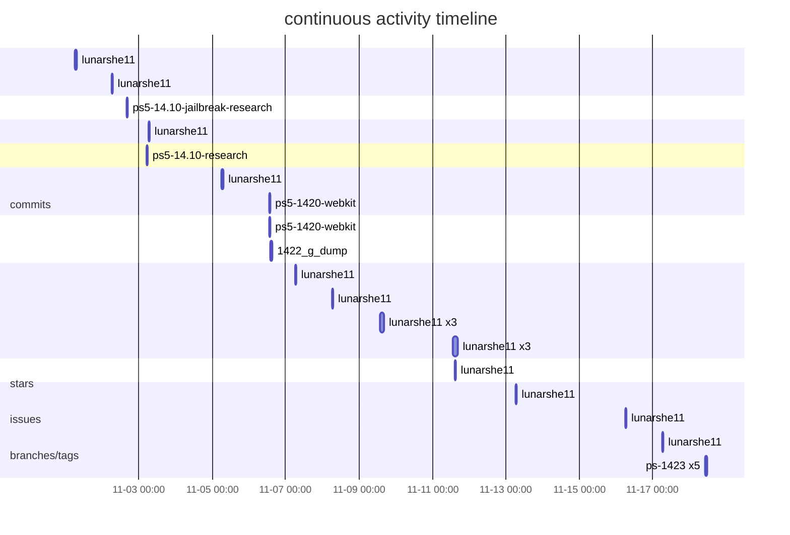
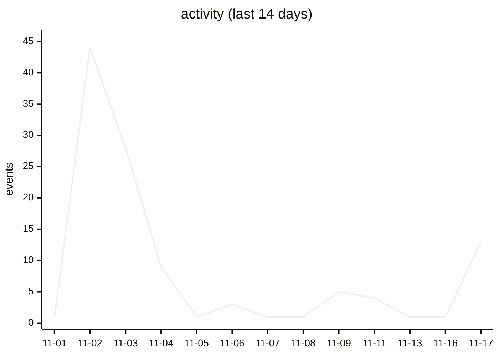
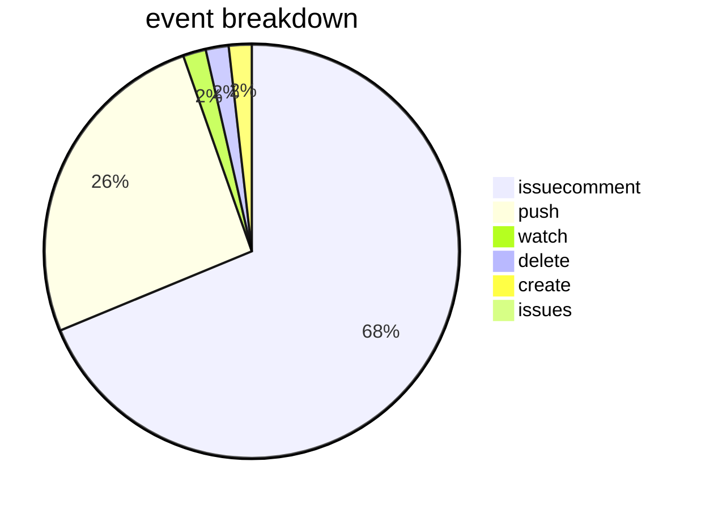

<div align="center">
  
</div>
<br>
<div align="center">
  <a href="https://wittylunar.space">website</a> &nbsp;&nbsp;•&nbsp;&nbsp;
  <a href="https://pinterest.com/lunarshe11/">pinterest</a> &nbsp;&nbsp;•&nbsp;&nbsp;
  <a href="https://vk.ru/wittylunar">vk</a>
</div>
<br>

<!-- activity_start -->






```text
lunarshe11@github
-----------------------
push > repo: lunarshe11
push > repo: lunarshe11
push > repo: lunarshe11
push > repo: lunarshe11
push > repo: lunarshe11
push > repo: ps-1423 (2026-11-17 10:50)
push > repo: ps-1423 (2026-11-17 10:49)
push > repo: ps-1423 (2026-11-17 10:48)
push > repo: ps-1423 (2026-11-17 10:46)
push > repo: ps-1423 (2026-11-17 10:45)
create > ps-1423 (2026-11-17 10:34)
create > moonshell (2026-11-17 10:28)
push > repo: lunarshe11 (2026-11-17 06:05)
push > repo: lunarshe11 (2026-11-16 06:05)
push > repo: lunarshe11 (2026-11-13 06:05)
push > repo: lunarshe11 (2026-11-11 14:42)
push > repo: lunarshe11 (2026-11-11 13:37)
push > repo: lunarshe11 (2026-11-11 14:34)
watch > repo: lunarshe11 (2026-11-11 14:30)
delete > repo: lunarshe11 (2026-11-09 14:07)
push > repo: lunarshe11 (2026-11-09 13:35)
push > repo: lunarshe11 (2026-11-09 16:58)
-----------------------
```
<!-- activity_end -->
