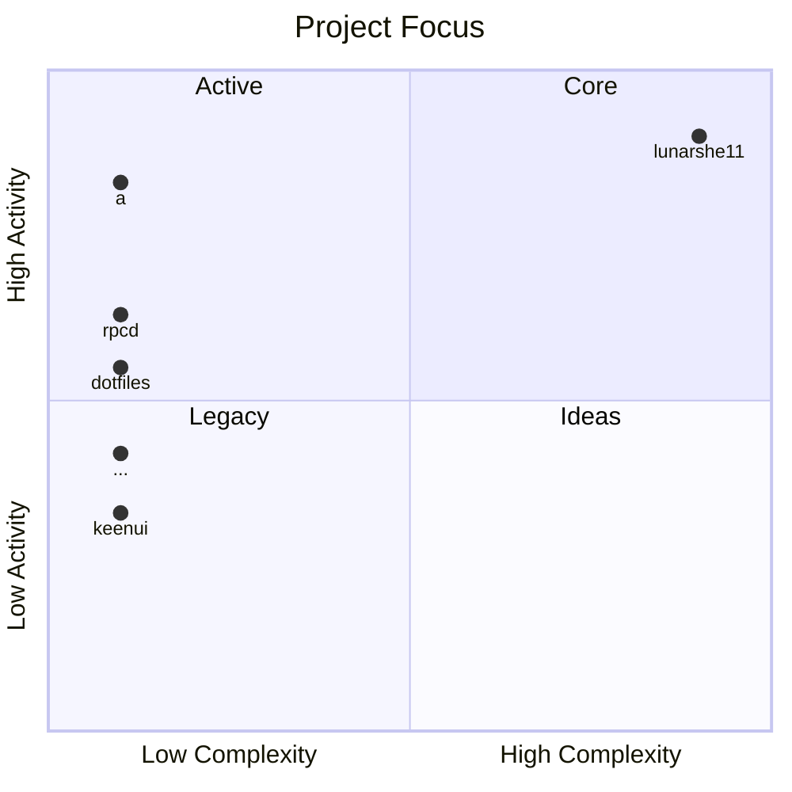
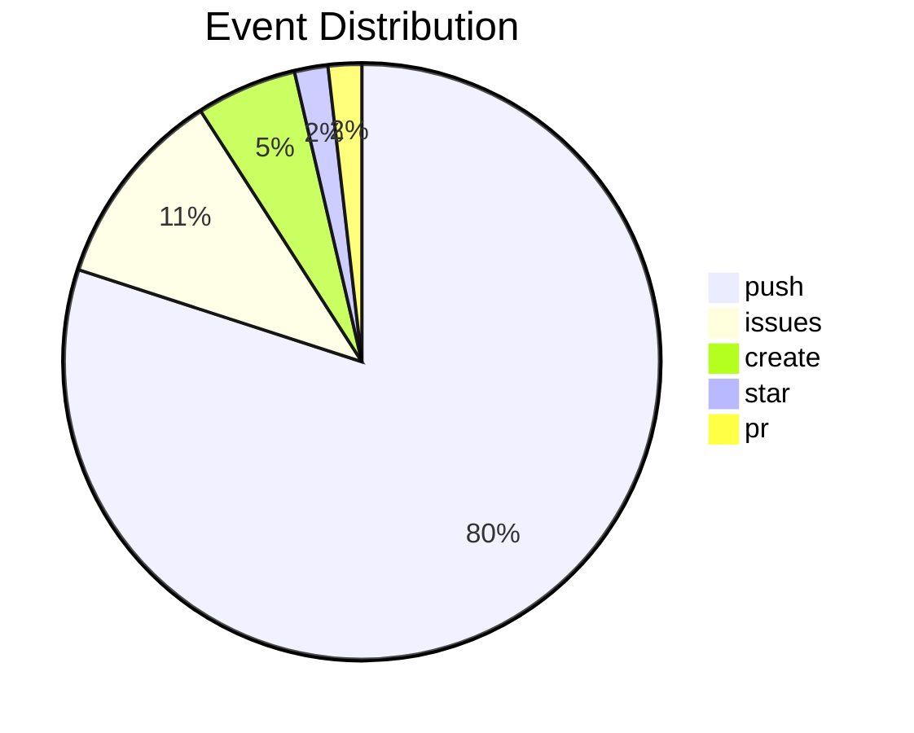
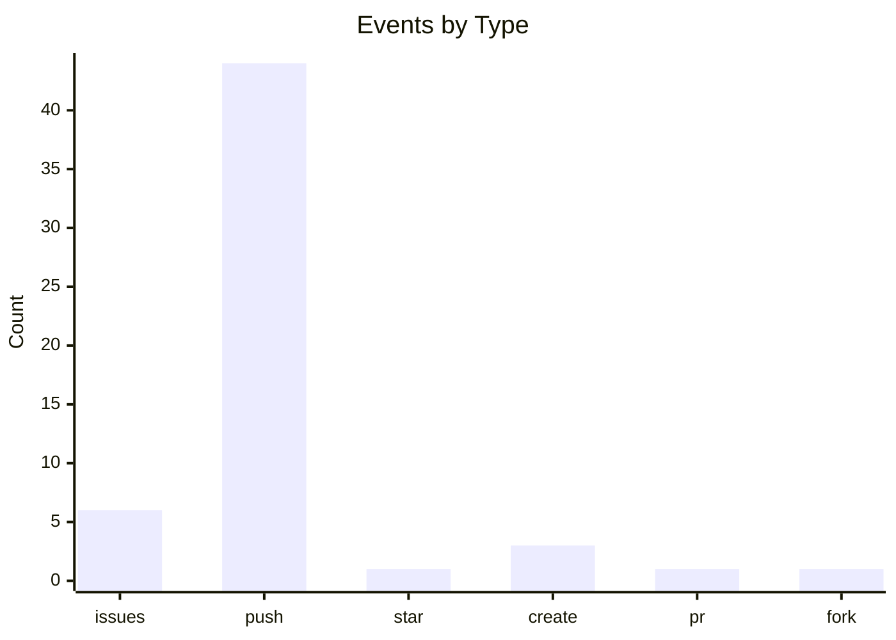

<div align="center">
  
</div>
<br>
<div align="center">
  <a href="https://wittylunar.space">website</a> &nbsp;&nbsp;•&nbsp;&nbsp;
  <a href="https://pinterest.com/lunarshe11/">pinterest</a> &nbsp;&nbsp;•&nbsp;&nbsp;
  <a href="https://vk.ru/wittylunar">vk</a>
</div>
<br>

<!-- ACTIVITY_START -->






```text
lunarshe11@github
-----------------------
issues > repo: PS5-14.10-Jailbreak-Research (2026-10-30 16:48)
issues > repo: PS5-14.10-Jailbreak-Research (2026-10-30 10:31)
push > repo: lunarshe11 (2026-10-29 06:05)
push > repo: lunarshe11 (2026-10-28 06:05)
push > repo: lunarshe11 (2026-10-27 16:12)
push > repo: lunarshe11 (2026-10-26 06:05)
push > repo: lunarshe11 (2026-10-25 05:11)
star > repo: PS5-14.10-Research (2026-10-25 05:07)
issues > repo: PS5-14.10-Research (2026-10-25 04:52)
issues > repo: PS5-14.10-Research (2026-10-24 14:38)
-----------------------
```
<!-- ACTIVITY_END -->
