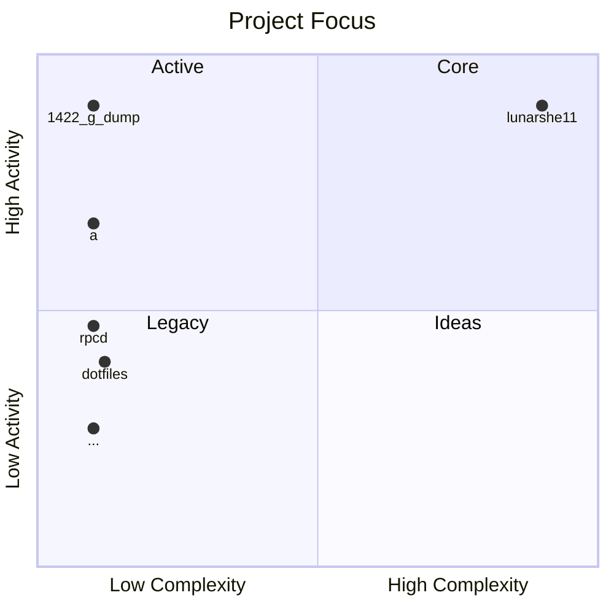
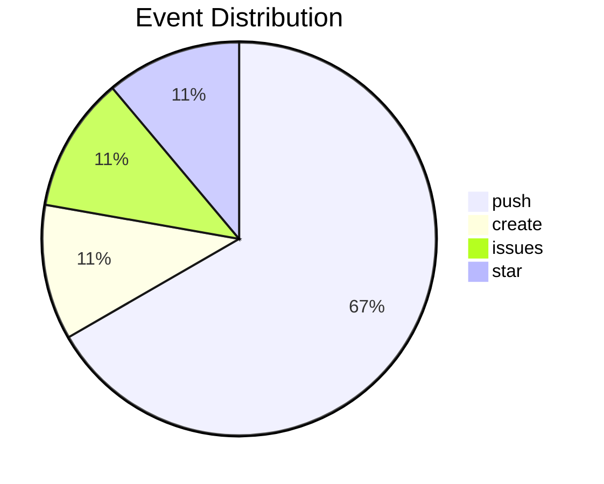
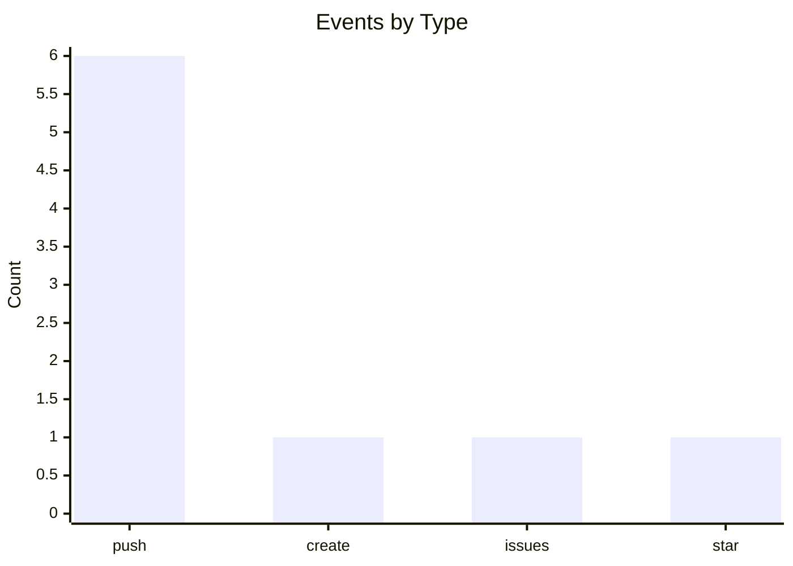

<div align="center">
  
</div>
<br>
<div align="center">
  <a href="https://wittylunar.space">website</a> &nbsp;&nbsp;•&nbsp;&nbsp;
  <a href="https://pinterest.com/lunarshe11/">pinterest</a> &nbsp;&nbsp;•&nbsp;&nbsp;
  <a href="https://vk.ru/wittylunar">vk</a>
</div>
<br>

<!-- ACTIVITY_START -->






```text
lunarshe11@github
-----------------------
push > repo: lunarshe11 (2026-11-08 06:05)
push > repo: lunarshe11 (2026-11-07 06:05)
create > repo: 1422_g_dump (2026-11-06 14:11)
push > repo: lunarshe11 (2026-11-05 06:05)
push > repo: lunarshe11 (2026-11-03 06:05)
push > repo: lunarshe11 (2026-11-02 06:05)
issues > repo: PS5-14.10-Research (2026-11-03 04:55)
push > repo: lunarshe11 (2026-11-01 06:05)
star > repo: PS5-14.10-Jailbreak-Research (2026-11-02 15:49)
-----------------------
```
<!-- ACTIVITY_END -->
