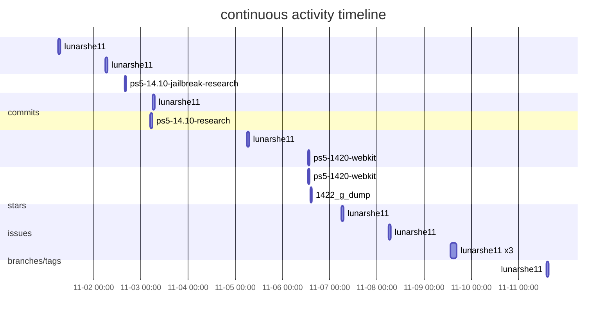
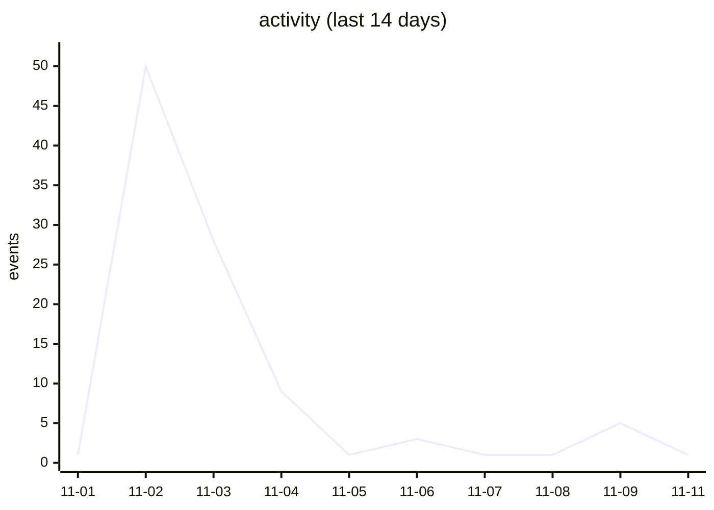
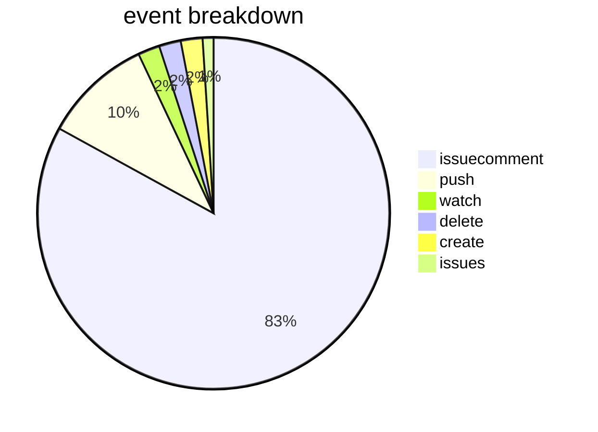

<div align="center">
  
</div>
<br>
<div align="center">
  <a href="https://wittylunar.space">website</a> &nbsp;&nbsp;•&nbsp;&nbsp;
  <a href="https://pinterest.com/lunarshe11/">pinterest</a> &nbsp;&nbsp;•&nbsp;&nbsp;
  <a href="https://vk.ru/wittylunar">vk</a>
</div>
<br>

<!-- activity_start -->






```text
lunarshe11@github
-----------------------
watch > repo: lunarshe11 (2026-11-11 14:30)
delete > repo: lunarshe11 (2026-11-09 14:07)
push > repo: lunarshe11 (2026-11-09 13:35)
push > repo: lunarshe11 (2026-11-09 16:58)
delete > repo: lunarshe11 (2026-11-09 13:36)
push > repo: lunarshe11 (2026-11-09 13:33)
push > repo: lunarshe11 (2026-11-08 06:05)
push > repo: lunarshe11 (2026-11-07 06:05)
push > repo: ps5-1420-webkit (2026-11-06 13:07)
create > repo: ps5-1420-webkit (2026-11-06 12:59)
-----------------------
```
<!-- activity_end -->
